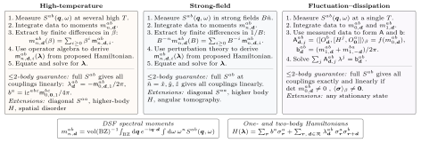

# Learning Quantum Hamiltonians from the Dynamical Structure Factor

Code and Lean proofs accompanying the paper.

Motivated by neutron scattering and quantum simulations, we study the problem
of learning a quantum Hamiltonian from the **dynamical structure factor**
(DSF), which captures two-point spin correlations as a function of momentum
and frequency.

We develop three Hamiltonian tomography protocols based on relations between
low-order DSF spectral moments and microscopic couplings. These moments are
frequency-weighted integrals of the DSF and correspond to short-time
derivatives of the two-point spin correlation function. The zeroth moment
divided by $2\pi$ gives the static spin structure factor.

## Methods at a glance



[LaTeX source](protocol-overview.tex)

| Protocol | Measurement regime | Reconstruction |
|---|---|---|
| [High-temperature (HT)](#high-temperature-tomography) | Temperatures large compared with the couplings | With full DSF access, the static structure factor at $O(\beta)$ gives linear equations. Diagonal DSF access gives polynomial equations. |
| [Strong-field (SF)](#strong-field-tomography) | A strong applied Zeeman field $B$ at low temperature | Centered first DSF spectral moments give linear equations at leading order in $1/B$. |
| [Fluctuation-dissipation (FD)](#fluctuation-dissipation-tomography) | Thermal equilibrium at a fixed temperature | Zeroth and first DSF spectral moments give an exact linear system for one- and two-body couplings. |

[Angular tomography](#angular-tomography) uses the dependence of the DSF on the
applied field direction to detect multispin interactions. We also benchmark against
[implicit neural representations](#implicit-neural-representations) for
supervised fitting of the DSF ([Chitturi et al., 2023](https://doi.org/10.1038/s41467-023-41378-4)).

The [Lean proofs](#lean-proofs) check the learning guarantees for one- and
two-body Hamiltonians in the Appendices.

## Figure reproduction

These commands redraw the figures from the data in this repository. They
start from the repository root.

| Figure | Command |
|---|---|
| [Main HT and SF comparison (Fig. 2)](#high-temperature-tomography) | `python ht/run.py plot` |
| [SF panels and supplement](#strong-field-tomography) | `python sf/run.py plot` |
| [Angular tomography (Fig. 4) and thermal supplement](#angular-tomography) | `python sf/angular/run.py plot` |
| [FD supplement](#fluctuation-dissipation-tomography) | `python fd/run.py plot` |
| [Implicit neural representation benchmark](#implicit-neural-representations) | `python inr/run.py plot` |

## High-temperature tomography

The HT protocol expands DSF spectral moments in powers of the inverse
temperature $\beta$. Local operator algebra gives the expansion coefficients
as polynomials in the Hamiltonian couplings. With diagonal DSF access, the
zeroth and second spectral moments give a polynomial system of degree at most
three with generic local solvability.

The figure shows how the relative coupling error varies with temperature,
DSF access, and measurement noise.

The [pinned requirements](ht/requirements.txt) list the plotting dependencies.
The plot command reads [data/results.npz](ht/data/results.npz) and writes
`runs/ht/figures/fig2_ht_sf_six_panel.pdf` and `.png`. It does not run quantum
simulations. The figure includes saved reference curves from the
[strong-field study](#strong-field-tomography).
The plotted values are also available in [data/plotted.csv](ht/data/plotted.csv).

<details>
<summary>High-temperature calculation settings and the Julia three-spin example</summary>

### Numerical calculations

For example, the three-versus-fifteen-feature comparison uses one
twelve-spin honeycomb Hamiltonian:

```sh
python ht/run.py calculate --study supplement --workers 1
```

| `--study` | What is recalculated |
|---|---|
| `temperature` | 270 zeroth DSF spectral moments for one honeycomb model at 141 temperatures, then reconstruction with measurement noise |
| `supplement` | Three versus fifteen bond correlations at 122 temperatures, then temperature and noise sweeps |
| `coefficients` | Recovery with full and diagonal DSF access for 1,000 twelve-parameter chains, including 95,000 local nonlinear fits |
| `parameters` | 64 honeycomb Hamiltonians at each of ten choices for the number of nonzero couplings, using the inverse temperatures selected on the validation set |

These commands perform new calculations and write arrays to
`runs/ht/work/`. The two ensemble studies resume by Hamiltonian and accept
one to four workers. They are substantially more work than plotting: the
parameter study alone requires thermal calculations for 640 Hamiltonians. Calculations
do not overwrite the bundled data; `plot` always uses those saved data.

[run.py](ht/run.py) contains the numerical benchmarks and reconstruction code.
Spin operators are Pauli matrices, the DSF spectral moments are divided by
$2\pi$, and $J_\star=1$. For diagonal DSF access, the chain solver starts at the
true couplings to test local stability. Its ribbons describe uncertainty in the
ensemble mean. The other ribbons describe variation across noise realizations
or Hamiltonians.
[settings.json](ht/data/settings.json) records noise, seeds, and aggregation.
`python ht/run.py check` runs the independent numerical and saved-data checks
in [test.py](ht/test.py).

### Three-spin symbolic example

The [symbolic example](ht/three_body.jl) studies a model with nineteen couplings,
including interactions among three spins. It is independent of the Python
benchmarks.

The Julia 1.11.1 example starts in the repository root.

```sh
julia --project=ht -e 'using Pkg; Pkg.instantiate()'
julia --threads=1 --project=ht ht/three_body.jl
```

The first command installs the pinned dependencies. The second generates
the polynomials for the DSF spectral moments using DynamicPolynomials.jl and
prints the saved numerical degree, $\mathsf g=2328$, for the selected nineteen
equations.
It does not search for roots. The exact Jacobian certificate and root
summaries are in [three_body.toml](ht/data/three_body.toml), alongside the
[polynomials](ht/data/three_body_polynomials.txt) and
[roots](ht/data/three_body_roots.csv).

`julia --threads=1 --project=ht ht/three_body.jl check` checks the algebra
against independent matrix traces using [test.jl](ht/test.jl).
For optional root calculations, the `search` argument selects homotopy
continuation, and `degree` selects monodromy and the numerical completeness
test. These longer computations write to `runs/ht/three_body/<command>/`.

</details>

## Strong-field tomography

In the SF protocol, a strong applied Zeeman field $B\hat{\boldsymbol n}$
polarizes the spins. At $T=0$, the DSF spectral moments admit a controlled
expansion in $1/B$. For one- and two-body interactions, the zeroth and first
spectral moments determine the couplings at sufficiently large $B$. This uses
three coordinate field directions with full DSF access or six suitably chosen
directions with diagonal DSF access.

The saved figures show how field strength, measurement noise, and the number
of unknown interactions affect recovery.

[Angular tomography](#angular-tomography) extends the SF protocol to detect
multispin interactions.

The [pinned requirements](sf/requirements.txt) list the plotting dependencies.
The plot command reads [data/](sf/data/) and writes to `runs/sf/figures/`:

- `sf_main.pdf/png`: the main-paper SF numerical panels.
- `sf_supplement.pdf/png`: momentum-averaged transverse DSF, relative coupling
  errors for two $J$–$K$–$\Gamma$ Hamiltonians, noise dependence, and recovery
  when some couplings are known.
- `plotted.csv`: the curve values, including points outside the displayed ranges.

No new diagonalization or training is needed for this command.

<details>
<summary>Strong-field code, calculation settings, and noise model</summary>

### Strong-field code

- **[physics.py](sf/physics.py)** builds the Pauli Hamiltonians, computes the DSF
  and its spectral moments, and constructs the leading-order coefficient matrix.
- **[run.py](sf/run.py)** reconstructs the couplings, adds measurement noise, summarizes
  errors, and provides the plotting and calculation commands.

### Optional recalculation

The following command recomputes one field point on one CPU worker.

```sh
python sf/run.py calculate --study field --index 0 --workers 1
```

Without an `--index` argument, the command covers the complete study.
`--workers` accepts 1 through 4.
Calculations save checkpoints in `runs/sf/work/` and resume completed points;
`--work-dir` selects another location. They write new results there without
replacing the packaged data used by `plot`.

| `--study` | Calculation |
|---|---|
| `field` | 42 fields through $B=100$, with moment noise $\sigma=0.005,0.01,0.02$ |
| `coefficients` | Full and diagonal DSF access for 1,000 twelve-parameter chains, with noise added to the exact leading expansion coefficients |
| `parameters` | 64 Hamiltonians at each of ten choices for the number of nonzero couplings, $p=1,3,6,\ldots,27$, at $B=32$ |
| `supplement` | Two $J$–$K$–$\Gamma$ targets at 77 fields, plus noise dependence at $B=32$ |
| `known` | The same 64 general exchange Hamiltonians at every $p=1,\ldots,27$, with $27-p$ couplings supplied exactly |
| `spectra` | Momentum-averaged transverse DSF at 97 fields |

### Model and reconstruction

The honeycomb cluster and chain each have 12 spins. Operators are Paulis,
$J_\star=1$, and all forward calculations use zero temperature. The applied
field is $-B\sum_i\hat n\cdot\boldsymbol\sigma_i$.

The $J$–$K$–$\Gamma$ studies use fields along $z$ and $(x-y)/\sqrt2$ and
281 centered first spectral moments. The family with 27 exchange couplings and the
twelve-parameter chain use $x,y,z,(x+y)/\sqrt2,(x+z)/\sqrt2,(y+z)/\sqrt2$.
Spatial probes include both honeycomb sublattices at their physical positions.

The normalized centered first spectral moments and the coupling estimate are

$c_\ell=\int_{0^+}^{\infty}\frac{d\omega}{2\pi}(\omega-2B)S_\ell(\omega),
\qquad \boldsymbol\lambda_{\mathrm{pred}}=\mathsf M^+\boldsymbol c.$

Here $\ell$ labels a field and probe setting. `physics.py` constructs the
coefficient matrix $\mathsf M$ from one-spin-flip matrix elements in the
polarized state. The finite-field moments average over the ground-state
manifold and include transitions out of it. The estimate solves the
leading-order equations by linear least squares, with $\mathsf M^+$ the
Moore–Penrose pseudoinverse.

`parameters` varies which interactions are present, with omitted coefficients
set to zero. `known` instead supplies some couplings exactly and subtracts
their contribution before fitting the rest. Both studies use unit-norm
coupling vectors. The two supplementary targets are
$(J,K,\Gamma)=(0.4,-0.7,0.2)$ and $(-0.7,0.4,-0.2)$.

### Noise and displayed quantities

We add independent Gaussian noise to the normalized DSF spectral moments,
with 5,000 noise realizations per target. Each realization gives a separate
coupling estimate. The chain study adds five noise realizations to the exact
leading expansion coefficients at each noise strength. The relative coupling
error is $\|\boldsymbol\lambda_{\mathrm{pred}}-\boldsymbol\lambda_{\mathrm{true}}\|_2/\|\boldsymbol\lambda_{\mathrm{true}}\|_2$.

Most curves show medians and central 25% intervals (37.5th–62.5th percentiles).
The chain curves show ensemble means with bootstrap-mean intervals. The
support-size study first takes each Hamiltonian's noise median; the
known-coupling study pools Hamiltonians and noise realizations.
[settings.json](sf/data/settings.json) records seeds, noise levels, and aggregation.

The heatmap shows the momentum-averaged transverse DSF
$\langle(S^{xx}+S^{yy})/(2\pi)\rangle_{\boldsymbol q}$. We average over 18
momenta and use Gaussian broadening with standard deviation $0.15$ and
frequency spacing $0.05$. The saved DSF averages the two spin channels.
The plot doubles this value to show their sum. The data include all computed
fields and a wider frequency window than the plot.

</details>

## Angular tomography

Angular tomography uses the dependence of a centered first DSF spectral moment
on the direction of the applied Zeeman field. At $T=0$ in the strong-field
limit, a nonzero spherical harmonic of angular momentum $\ell$ certifies an
interaction involving at least $\ell$ spins. Spheres show the angular DSF with
its angular mean subtracted. Bars show the spherical harmonic amplitudes.

The main figure shows the ideal strong-field limit on a honeycomb lattice.
The supplement shows what changes at finite field and temperature on
honeycomb and square lattices.

The [pinned requirements](sf/angular/requirements.txt) list the plotting
dependencies. The plot command reads the included data and writes `angular_main.pdf/png`,
`angular_supplement.pdf/png`, `plotted.csv`, and `render.json` under
`runs/sf/angular/figures/`. No diagonalization is needed. Fonts use Avenir
and Times New Roman when available, with portable fallbacks recorded in
`render.json`.

<details>
<summary>Angular models, observables, and checks</summary>

### Angular tomography code

| File | Contents |
|---|---|
| [physics.py](sf/angular/physics.py) | Lattices, Pauli interactions, polarized-state polynomials, harmonics, and complete thermal traces. |
| [run.py](sf/angular/run.py) | Figure rendering and data checks. |

The single [data/](sf/angular/data/) directory holds `ideal.npz`, `thermal.npz`,
`settings.json`, and `artwork.pdf`. The PDF collects the fixed vector artwork;
the spheres, numerical histograms, and color scales are rendered from the data.
Settings include the temperature and field-direction grids, source hashes, and
the artwork layout.

### Hamiltonians and spectral moments

The Hamiltonians in each sequence are $V_2$, $V_2+V_3$, and $V_2+V_3+V_4$.
All spin operators are Pauli matrices. Before the main figure's display
rescaling, every nonzero Pauli coefficient has magnitude one.

| Lattice | Two spins | Three spins | Four spins |
|---|---|---|---|
| Honeycomb | $-\sigma_i^a\sigma_j^a$ on each $a$ bond | $-\sigma_i^a\sigma_j^c\sigma_k^b$ along an $a,b$ path | $+\sigma_i^a\sigma_j^c\sigma_k^a\sigma_l^c$ along an $a,b,c$ path |
| Square | $-X_rX_{r+\hat x}-Z_rZ_{r+\hat y}$ | $-X_{r+s\hat x}Y_rZ_{r+t\hat y}$ for $s,t=\pm1$ | $-8(T_1^+T_2^-T_3^+T_4^-+\mathrm{h.c.})$ around each plaquette |

Honeycomb $a,b,c$ are distinct axes, and paths are counted once up to reversal.
The square ring uses $T^\pm=(Z\pm iX)/2$ and consecutive plaquette sites.
It is anisotropic ring exchange. `terms()` spells out every Pauli word and sign.

For $H_B=V_{\le k}-B\sum_i\hat n\cdot\boldsymbol\sigma_i$, the thermal calculation uses

$$
\mathcal C(\hat n)=\frac{1}{2|\mathcal B|}\operatorname{Re}\sum_{(i,j)\in\mathcal B,a}
\left[\langle\sigma_i^a[H_B,\sigma_j^a]\rangle
-2B\left(\langle\sigma_i^a\sigma_j^a\rangle
-\langle\sigma_i^a\rangle\langle\sigma_j^a\rangle\right)\right].
$$

This is the real part of the spin-traced, centered first spectral moment of
the connected DSF, normalized by $2\pi$.
The probes $\mathcal B$ are honeycomb $z$ bonds or horizontal square bonds.
Only the coherent product of means is removed; complete thermal traces retain
all signed-frequency and incoherent zero-frequency weight.

Spheres show $\mathcal C$ minus its angular mean. Histograms use
$A_\ell=[\sum_m|\mathcal C_{\ell m}|^2/(4\pi)]^{1/2}$, independent of sphere colors.
The main figure rescales each whole Hamiltonian to equal $\sum_{\ell\ge1}A_\ell$,
leaving the two-body example unscaled; the raw data remain unscaled.
The supplement uses the original coefficients, periodic $N=12$ clusters,
$B=32$, and $T/B=0.1$, with no measurement noise. Its small harmonics above
the interaction order are finite-field/temperature corrections.

### Checks

```sh
python sf/angular/run.py check
python sf/angular/run.py check --physics
```

The first checks input hashes, regenerates the ideal polynomials, and replays
the harmonic decomposition at all 26 saved temperatures on both angular grids
(288 and 512 directions). The second also diagonalizes six fresh $N=12$
cases and compares their complete thermal traces with the saved data.

</details>

## Fluctuation-dissipation tomography

The fluctuation-dissipation theorem gives an exact linear system
$\mathsf A\boldsymbol\lambda=\mathsf b$ in thermal equilibrium. For one- and
two-body Hamiltonians, the zeroth DSF spectral moments determine $\mathsf A$,
and the symmetrized first DSF spectral moments give $\mathsf b$. The supplement
figures show how the relative coupling error depends on temperature,
measurement noise, and Hamiltonian symmetry.

The [pinned requirements](fd/requirements.txt) list the plotting dependencies.
The plot command writes `fig1_matrix_fdt` and `fig2_symmetry_ensembles` as
PDF, PNG, and CSV files under `runs/fd/figures/`. The CSVs include all 47
temperatures per curve, including values above the displayed error range.

<details>
<summary>FD estimator, supplement data, and checks</summary>

### FD code and estimator

[physics.py](fd/physics.py) constructs the linear system and solves it. It also
calculates normalized DSF spectral moments for small periodic lattices by
exact diagonalization (ED). [run.py](fd/run.py) replays the worked-chain
fits, summarizes the symmetry ensembles, and draws both figures.

All spin operators are Pauli matrices. In the two-bond families, the physical
coupling vector has three field components and two ordered $3\times3$ exchange
matrices. The 21 zeroth-moment inputs $\boldsymbol c$ are the magnetization and
the two bond-correlation matrices. The right-hand side $\mathsf b$ has nine
symmetrized first spectral moments on each bond and six onsite components,
with $\mathsf b^{ab}_{\boldsymbol d}=(m_{1,\boldsymbol d}^{ab}+m_{1,-\boldsymbol d}^{ba})/(2\pi)$.

The code evaluates the double commutators using Pauli algebra to obtain
$\mathsf A(\boldsymbol c)$. For a given symmetry, $R$ maps the independent
parameters $\boldsymbol\theta$ to the full coupling vector. The reconstruction
solves $\mathsf A R\boldsymbol\theta\simeq\mathsf b$ by least squares with a
relative singular-value cutoff of $10^{-12}$. Both $\mathsf A$ and $\mathsf b$
use noisy DSF spectral moments. The predicted couplings are
$\boldsymbol\lambda_{\mathrm{pred}}=R\widehat{\boldsymbol\theta}$, and the
figures show the relative coupling error.

The raw Gaussian component standard deviations are $0.01$, $0.02$, and $0.05$.
Each fit uses the mean of 100 observations. Most trials draw this mean directly
with standard deviation $\sigma/10$. The XYZ MPS curve replays the explicit
averages used in the original calculation. Ribbons span the 37.5th to 62.5th
percentiles.

### FD supplement figures

- **Worked chains.** Periodic $N=16$ ED and infinite-chain MPS supply three
  nearest-neighbor correlations. The code forms six symmetrized first spectral
  moments from the noiseless sum rule and replays 5,000 noisy fits per setting. The couplings are
  XYZ $(0.4,0.2,-1)$, XXZ $(J_\perp,J_z)=(1,1.5)$, and Heisenberg $J=1$.
  Temperatures follow the saved $1/\beta$ grid in fixed energy units. The MPS
  circle is the ground state, and the coldest ED point is at finite $\beta=1000$.
- **Symmetry ensembles.** Periodic $N=12$ chains with nearest- and next-nearest-neighbor interactions and
  $4\times3$ square lattices each use 1,000 Hamiltonians per symmetry class. SU(2),
  U(1), $\mathbb Z_2$, and generic families have 2, 7, 11, and 21 independent
  couplings drawn uniformly from $[-1,1]$. ED supplies the zeroth and first DSF
  spectral moments independently. The figure takes quantiles across
  the saved per-Hamiltonian medians of 100 noisy fits, including members
  with rank-deficient reconstruction matrices.

[Data](fd/data/) contains two archives. `moments.npz` holds the worked-chain
correlations, one full moment record per symmetry panel, and the U(1)
ground-state statics. `ensemble.npz` holds the medians for all 8,000
Hamiltonians at the three noise strengths and 47 temperatures. The plot
command starts from these saved data. The check command replays the eight
archived fits, verifies recovery from newly computed six-spin ED moments,
and checks the U(1) ground-state rank against magnetization. For the two
geometries, the unmagnetized and saturated populations give ranks six and
five respectively.

```sh
python fd/run.py check
```

The source archives are the worked-chain
`chain_sixrow/six_panel/average100_beta1000_mc5000/figure_data.npz`
and the chain and square `results.npz` under
`average_case_N12_blocks_20261011/` in the original FD calculations.

</details>

## Implicit neural representations

We train an implicit neural representation (INR) of the DSF as a function of
the Hamiltonian couplings, momentum, frequency, and polarization. We then fix
the network weights and infer the couplings by fitting the predicted DSF to the
test data.

The figure shows the relative coupling error as a function of training set
size $N_{\mathrm{train}}$. We compare with the HT, SF, and FD protocols on the
same test Hamiltonians.

The saved-data commands use NumPy and Matplotlib, with versions listed in the
[pinned requirements](inr/requirements.txt). `python inr/run.py check` verifies
the saved data and statistics. The plot command writes
`runs/inr/figures/inr_benchmark_N12.pdf` and `.png`, with the plotted values in
`.csv` and plotting metadata in `.json`.

<details>
<summary>Neural benchmark settings, training, and reconstruction</summary>

### Benchmark setup

We fit $J,K,\Gamma$ on a periodic 12-spin honeycomb cluster. The INR uses the
DSF at zero field and temperature. HT uses $\beta=0.05$, SF uses $B=32$ at
$T=0$, and FD uses zero-temperature DSF spectral moments. The comparison uses
noiseless data.

### What is included

| File | Contents |
|---|---|
| [run.py](inr/run.py) | Commands, result summaries, and plotting |
| [inr.py](inr/inr.py) | Sine network, training, and coupling fitting |
| [physics.py](inr/physics.py) | Honeycomb Hamiltonian, DSF, and HT/SF/FD references |
| [test.py](inr/test.py) | Saved-data, physics, and training checks |
| [data/](inr/data/) | Couplings, estimates, moments, training history, and provenance |

The plot uses the saved numerical results. The optional calculations below
generate the DSF training data and network checkpoints.

| Setting | Value |
|---|---|
| Couplings | $(J,K,\Gamma)\in[-1,1]^3$, disjoint scrambled-Sobol populations |
| Hamiltonians | 2,048 training, 128 validation, 16 test |
| Nested training set sizes | 8, 16, 32, 64, 128, 256, 512, 1,024, 2,048; two seeds each |
| Network | Five layers of width 128 with sine activations and nonnegative spectral weights |
| Training and coupling-fitting objective | Generalized KL divergence (GKL) |
| DSF data | Inelastic DSF with Gaussian broadening of standard deviation $0.15$ and frequency spacing $0.05$ |
| Statistics | Median and central 25% across test Hamiltonians and training seeds |

The intensity calibration rescales the simulated DSF. FD uses exact DSF
spectral moments, and the INR uses the broadened DSF. The settings and training
history record the protocol, validation loss, and convergence.
[Settings](inr/data/settings.json) · [Training history](inr/data/training.csv)

### Optional calculations

The full calculation generates DSF data for 2,192 Hamiltonians and trains 18
networks. It takes substantially longer than plotting the saved results. The commands below
install the compute dependencies and run a short synthetic CPU check.

```sh
python -m pip install -r inr/requirements-compute.txt
python inr/run.py smoke
python inr/test.py
```

The complete benchmark uses the following sequence.

```sh
python inr/run.py init
python inr/run.py generate --workers 4
python inr/run.py train --device auto
python inr/run.py fit --device auto
python inr/run.py references --workers 4
python inr/run.py collect
python inr/run.py plot --data runs/inr/work/summary
```

Calculations resume from `runs/inr/work/`; `--work-dir` selects another location.
`auto` uses CUDA when available and otherwise CPU; `--device mps` selects an
Apple GPU. `--help` lists options for individual budgets, seeds, and targets.
`check --physics` also recomputes one complete 12-spin reference.

</details>

## Lean proofs

[](https://github.com/nisargapaul/LearningDSF/actions/workflows/lean.yml)

We use Lean to check the Theorems in the Appendices.

The package proves recovery from DSF spectral moments for spin-$\frac12$
Hamiltonians with one- and two-body interactions. It covers high-temperature (HT),
strong-field (SF), and fluctuation-dissipation (FD) tomography in finite volume
and periodic thermodynamic limits. It also proves the finite-volume angular
tomography identity for arbitrary many-spin interactions.

### Lean build and audit

The build uses Git and `elan`, Lean's toolchain manager. The [Lean installation
guide](https://lean-lang.org/install/) covers setup. The commands below start
in the root of a local clone.

```sh
cd lean
lake exe cache get
lake build
lake env lean tests/Audit.lean
```

`lake` is Lean's build tool. The first command downloads compiled mathlib
libraries, so they need not be rebuilt locally. `elan` selects Lean 4.24.0 from
[lean-toolchain](lean/lean-toolchain), and [lake-manifest.json](lean/lake-manifest.json)
fixes the dependency commits. The first run needs an internet connection.
Later runs reuse the local `.lake/` directory. A new terminal picks up the
updated executable path after `elan` is installed.

A successful build ends with `Build completed successfully`. The final command
should end with `Axiom audit passed for 183 public results.` The
[CI workflow](.github/workflows/lean.yml) runs the same build and audit from a
fresh checkout.

### Proof walkthrough

The [matrix inverse](lean/src/DSFTomography/Inverse.lean) is a short example.
[Finite-volume FD recovery](lean/src/DSFTomography/FD.lean) shows a tomography
proof. A `def` gives a formula. A `theorem` states hypotheses and a conclusion.
The code after `:= by` proves it. In VS Code, the Lean 4 extension shows the
current goal when the cursor is inside a proof.

<details>
<summary>Lean audit, model assumptions, and theorem statements</summary>

### What is checked

`lake build` asks Lean to check each proof against its stated hypotheses and
conclusion.
[Audit.lean](lean/tests/Audit.lean) then traverses the proof dependencies of 183 public
results. It rejects proof placeholders and every axiom except `propext`,
`Classical.choice`, and `Quot.sound`, Lean's standard logical foundations.
This audit covers each listed result and every lemma it uses.

The package proves the mathematical recovery claims below. It does not run the
numerical experiments or certify their implementation, statistical sample
complexity, or reconstruction runtime.

### Results

| Protocol | What is proved | Main source |
|---|---|---|
| HT, full access | The coefficient of $\beta$ in the static structure factor determines all couplings linearly and uniquely. | [HT recovery](lean/src/DSFTomography/DSFInfiniteHT.lean) |
| HT, diagonal access | Polynomial equations of degree at most three give generic local solvability from diagonal DSF data. | [Jacobian witness](lean/src/DSFTomography/HTDiagonalWitness.lean) · [Recovery](lean/src/DSFTomography/DSFInfiniteHT.lean) |
| SF, full access | Three coordinate field directions give global solvability at sufficiently large $B$ with full DSF access. | [SF recovery](lean/src/DSFTomography/DSFInfiniteSF.lean) |
| SF, diagonal access | Six suitably chosen field directions give global solvability at sufficiently large $B$ with diagonal DSF access, including elastic subtraction from the measured data. | [Six-direction protocol](lean/src/DSFTomography/SFSixSpectra.lean) |
| Angular | The spin-traced connected centered DSF moment tends to the one-spin-flip matrix element, with an $O(1/B)$ error at fixed finite volume. | [Angular identity](lean/src/DSFTomography/SFAngular.lean) |
| FD | Zeroth and first DSF spectral moments give exact recovery under the bond-correlation and magnetization conditions, with an error bound for exchange couplings. | [FD recovery and accuracy](lean/src/DSFTomography/DSFInfiniteRecovery.lean) |

HT takes the volume limit before differentiating at $\beta=0$. The proofs include
partition-function zero-freeness and uniform convergence of local Gibbs traces.
Diagonal HT establishes local recovery; discrete ambiguities can remain.

SF includes a volume-uniform ground-state expansion and finite-field remainder
bounds. The leading-order linear estimator has $O(1/B)$ truncation error. The finite-field
theorem establishes global solvability at sufficiently large $B$. The
six directions are $x,y,z,(x-y)/\sqrt2,(x-z)/\sqrt2,(y-z)/\sqrt2$.

Angular tomography allows an arbitrary Hermitian interaction, including
higher-body terms. For distinct sites $r,s$, the proved identity is

$$
\lim_{B\to\infty}\frac12\sum_a\int\frac{d\omega}{2\pi}
(\omega-2B)S^{aa}_{r,s,\mathrm{conn}}(\omega)
=\langle r;\hat n|H|s;\hat n\rangle.
$$

The proof constructs the smooth ground state, derives the spectral moments,
and proves the cancellation of the first-order state corrections. A real
orthonormal frame represents the field direction and laboratory spin axes.
The angular remainder bound is for fixed finite volume; its constants may
depend on the system. The spherical-harmonic cutoff is not part of this result.

FD recovers each bond whose static correlation matrix is nonsingular. Field
recovery requires all exchanges in the onsite subtraction and nonzero measured
magnetization. For couplings bounded by one, Frobenius errors at most $\epsilon$
in the static and symmetrized first-moment matrices, and a measured static
determinant of magnitude at least $\gamma>0$, the exchange estimate satisfies

$$
\max_{a,b}|\widehat J_d^{ab}-J_d^{ab}|
\le \frac{25(1+\epsilon)^2}{4\gamma}\,\epsilon.
$$

### Model and conventions

$$
H=\sum_{r,a}b^a\sigma_r^a+
\sum_{r,d\in\mathcal R,a,b}J_d^{ab}\sigma_r^a\sigma_{r+d}^b.
$$

The operators are Pauli matrices. Thermodynamic results use growing periodic boxes of a
fixed finite-range model on a Bravais lattice.

The proofs connect the Heisenberg time-Fourier DSF to Lehmann moments, with the
paper's $2\pi$ normalization. HT and FD retain elastic weight. SF uses connected
statics. Infinite-volume DSFs are tempered distributions, with moments defined
by smooth cutoffs and spatial Fourier pairing in summable coefficient
coordinates. At general temperature, FD applies to every constructed
subsequential limit satisfying its measured conditions. HT and SF have
full-sequence moment limits in their respective regimes.

### Lean theorem declarations

The declaration `import DSFTomography` loads the package in a Lean file.
The entry points below have the prefix `DSFTomography.`.

| Result | Declaration |
|---|---|
| Full-access HT | `Spectral.fullAccessHT_infinite_DSF` |
| Diagonal HT | `Spectral.Diagonal.generic_local_solvability` |
| Full-access SF | `Spectral.fullAccessSF_infinite_DSF` |
| Six-direction diagonal SF | `SF.DiagonalSix.six_direction_protocol` |
| Angular DSF identity | `SF.Angular.angular_tomography_finite` |
| Angular finite-field error | `SF.Angular.angular_error_finite` |
| FD recovery | `Spectral.BulkDSF.fd_from_infinite_DSF` |
| FD accuracy | `Spectral.BulkDSF.fd_accuracy_infinite_DSF` |

The sources are in `lean/src/` and the axiom audit is in `lean/tests/`. Each theorem states
its measurement and nondegeneracy assumptions explicitly. Complex-fiber degree
and global uniqueness for diagonal HT are outside these results.

</details>


We used Codex, primarily with GPT-6.1, to develop the code, curate this
repository, and formalize the proofs in Lean.
